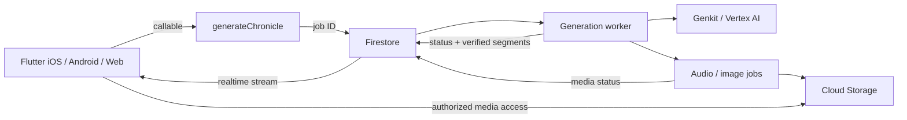

# Öv AI / Mongol Chronicles — Flutter mobile шилжилтийн шинжилгээ

Огноо: 2026-10-15, Asia/Ulaanbaatar.

## 1. Шийдвэрийн санал

**Энэ загварыг Flutter дээр iOS, Android апп болгох боломжтой. Хийх ажил нь загварын дагуу Flutter UI бүтээж, бодит өгөгдөл ба backend холбох ажил юм.** Одоогийн HTML/React кодыг Dart руу хөрвүүлээд бэлэн ажиллагаатай апп гаргах нөхцөл алга.

Зөвлөмж: Flutter клиент + Firebase Auth/Firestore/Storage + TypeScript Cloud Functions/Genkit сервер. Нэг Flutter төслөөс mobile болон web хувилбар гаргана. Платформын permission, background audio, cache, release тохиргоог тус бүрд нь шалгана. Flutter нь нэг codebase-аас эдгээр платформыг дэмждэг. [Flutter web support](https://docs.flutter.dev/platform-integration/web)

Эхний ажиллах хувилбар: **зочин → 4 газрын зураг/жагсаалт → газар сонгох → chronicle тохируулах → серверийн явц → баримт, эх сурвалжтай Reader → аудио → миний бүтээлүүд**.

## 2. Шинжилгээний үндэс ба хязгаар

Шалгасан зүйлс:

- `/Users/amarmurunmandakh/Downloads/Working app · iPhone-html` доторх HTML, navigation, компонент, token, asset.
- [Agent design](/Users/amarmurunmandakh/Downloads/2026-10-15-ai-builder-cup-agents-design.md).
- [System/database concept](/Users/amarmurunmandakh/Downloads/2026-10-15-system-and-database-concept.md).
- Browser дээр welcome → signup → guest → Steppe урсгал.
- Энэ компьютерийн хөгжүүлэлтийн хэрэгслүүдийн хязгаарлагдмал шалгалт, Flutter/Firebase/package-ийн албан ёсны баримт.

Хавсаргасан баримтуудыг архитектур, бүтээгдэхүүний төлөвлөгөөний эх сурвалж гэж авч үзэв. Доторх deploy, public repo, billing болон багийн эрхийн checklist нь энэ хүсэлтээр гүйцэтгэх тушаал биш. Энэ удаа шинжилгээ хийж, энэхүү тайланг үүсгэв; апп код, cloud төсөл, deployment үүсгээгүй.

Эхний баримт Next.js, web-only шийдвэртэй. Хоёр дахь баримт Flutter/Firebase хувилбараар тэр хэсгийг орлуулах саналтай бөгөөд өөрөө «ноорог» статустай. Flutter хийх гэсэн хэрэглэгчийн одоогийн хүсэлтэй нийцүүлэн хоёр дахь хувилбарыг суурь болгож үнэлэв. Эдгээр нь ажиллаж буй backend-ийн нотолгоо биш. Тэмцээний хугацаа, дүрмийг тусад нь баталгаажуулаагүй.

## 3. Одоогийн export яг юу вэ?

[README](</Users/amarmurunmandakh/Downloads/Working app · iPhone-html/README.md:3>) нь үүнийг design reference mockup гэж тодорхойлдог. `package.json`, Flutter `pubspec.yaml`, application backend, Firebase configuration байхгүй. React ба `support.js` нь экспортын загварыг дүрслэх runtime юм.

Нийт 23 `.dc.html` файл: 19 route дэлгэц + `App` shell + `FloatingNav`, `SteppeMap`, `NarrationPlayer` гэсэн 3 туслах компонент.

| Бүлэг | Дэлгэцүүд | Flutter хувилбарт хийх ажил |
|---|---|---|
| Эхлэл, account | Main, SignUp | Welcome; anonymous session; дараа нь бодит account linking |
| Газар хайх | Steppe | Map/list, 4 site, газар сонгох sheet, filter |
| Бүтээл үүсгэх | InscribePlace, InscribeTone, InscribeVoice, Writing | Нэгдсэн draft state, validation, callable, job progress |
| Унших | Reader, ReaderEnd | Нэг үргэлжилсэн Reader; fact/legend, citation sheet, verifier summary |
| Сан, profile | Scrolls, Orda | User query, хадгалсан бүтээл, account state |
| Аялал | FieldMap, Geofence, Offline | Бодит байршил, permission, offline cache; дараагийн үе шат |
| Нэмэлт | Journey, ShareCard, Playback, Settings, Downloads | Route progress, share, audio lifecycle, persistent settings, download manager |

Үндсэн дөрвөн tab нь Steppe, Inscribe, Scrolls, Profile. Flutter-д энэ бүтцийг хадгалж болно. 19 дэлгэцийг заавал 19 тусдаа page болгох шаардлагагүй: Reader/ReaderEnd нэг page, site detail болон citation нь bottom sheet байж болно.

### Одоо ажиллаж байгаа ба дуурайлгасан хэсгүүд

| Боломж | Одоогийн бодит байдал | Нотолгоо |
|---|---|---|
| Navigation, сонголт | Memory доторх stack, chip/radio/toggle ажиллана | [App:53](</Users/amarmurunmandakh/Downloads/Working app · iPhone-html/App.dc.html:53>) |
| Нэвтрэлт | Товч дарахад guest flag өөрчилнө; credential шалгахгүй | [App:83](</Users/amarmurunmandakh/Downloads/Working app · iPhone-html/App.dc.html:83>) |
| AI generation | 4.2 секундийн дараа бэлэн Reader нээнэ | [App:121](</Users/amarmurunmandakh/Downloads/Working app · iPhone-html/App.dc.html:121>) |
| Geofence | FieldMap дээр 6 секунд болоход arrival дэлгэц гарна | [App:122](</Users/amarmurunmandakh/Downloads/Working app · iPhone-html/App.dc.html:122>) |
| Аудио | Секунд тоолдог timer; бодит audio playback байхгүй | [NarrationPlayer:65](</Users/amarmurunmandakh/Downloads/Working app · iPhone-html/NarrationPlayer.dc.html:65>) |
| Газрын зураг | SVG зураг; pan/zoom/GPS map engine биш | [SteppeMap:21](</Users/amarmurunmandakh/Downloads/Working app · iPhone-html/SteppeMap.dc.html:21>) |
| Camera/upload | Сонгосон option-ийн төлөв өөрчилнө | [InscribePlace:81](</Users/amarmurunmandakh/Downloads/Working app · iPhone-html/InscribePlace.dc.html:81>) |
| Downloads | Хувийг timer-аар өсгөнө; файл татахгүй | [Downloads:111](</Users/amarmurunmandakh/Downloads/Working app · iPhone-html/Downloads.dc.html:111>) |
| Share/save/PDF | Preview болон товчнууд; бүрэн implementation байхгүй | [ShareCard:44](</Users/amarmurunmandakh/Downloads/Working app · iPhone-html/ShareCard.dc.html:44>) |

Энэ export-д application API, бодит authentication, database integration болон durable persistence илрээгүй. Өөр газар backend байгаа эсэхийг энэ шалгалтаар тогтоогоогүй.

Нэг чухал зөрүү: Tone дэлгэцийн сонголтууд дараагийн алхамд дамждаггүй. Voice дэлгэцийн summary нь тогтмол тексттэй ([InscribeVoice:49](</Users/amarmurunmandakh/Downloads/Working app · iPhone-html/InscribeVoice.dc.html:49>)). Flutter-д бүх алхмын дундын `ChronicleDraft` шаардлагатай.

## 4. Юуг дахин ашиглаж болох вэ?

| Материал | Ашиглах хэлбэр |
|---|---|
| 5 JPG + 1 SVG, нийт ойролцоогоор 1 MB | Flutter bundled assets; hero, illustration, decoration |
| `tokens.json`, `tokens.css` | `ThemeData`, `TextTheme`, `ThemeExtension`, spacing/radius constants |
| Geret компонентуудын загвар | Flutter button, chip, card, sheet, navigation, player widget-ийн спецификаци |
| SVG icon/logo path | Standalone SVG болгон салгах эсвэл vector widget болгох |
| Дэлгэцийн урсгал, текст, sample content | UX reference болон fixture data |
| React, HTML, CSS, `support.js` | Flutter runtime-д шууд ашиглахгүй; widget-ээр хэрэгжүүлнэ |

Өнгийн суурь: cream `#F2EFE7`, night `#0C1F14`, green `#1F4D2E`, gold `#C9A227`, brown `#7A4E2B`. Spacing: 4/8/12/16/20/24/32/48/64/72. Radius: 5/16/28/pill. Эдгээр нь UI-г дахин дизайн хийхгүйгээр тогтвортой хэрэгжүүлэхэд хангалттай эхлэл.

Font-ийн асуудал: Poppins, Inter, Cyrillic fallback зарласан ч холбогдох `fonts/*.woff2` файлууд export-д алга. Mobile-д тохирох font файлыг олж bundle хийх, Монгол кирилл болон үсгийн хэмжээг өсгөх үед layout шалгах шаардлагатай. Essential жижиг текстэд light theme-ийн muted өнгийг шууд хэрэглэхгүй: token тайлбар өөрөө contrast асуудал тэмдэглэсэн.

## 5. Flutter хэрэгжүүлэлтийн сонголт

| Хувилбар | Давуу тал | Энэ төсөлд үнэлгээ |
|---|---|---|
| Flutter widget-ээр бүтээх | Нэгдсэн UI/state, native plugin, нэг mobile/web codebase | Үндсэн санал; бодит аппын суурь |
| Flutter WebView дотор export нээх | Одоогийн харагдах байдлыг хурдан үзүүлнэ | Богино prototype-д боломжтой; simulated боломжууд хэвээр, plugin bridge ба шинэ backend ажил үлдэнэ |
| Web ба mobile хоёр тусдаа UI | Web-ийн document/SEO урсгалыг бие даалгаж болно | Хожим public content/marketing хэрэгцээ өсвөл үнэлнэ; одоохондоо багийн ачаалал нэмнэ |

### Клиентийн санал болгож буй бүтэц

| Үүрэг | Сонголт | Яагаад |
|---|---|---|
| State ба dependency | `flutter_riverpod` | Async stream, draft, session, player state-ийг widget-ээс тусгаарлана |
| Navigation | `go_router` | Mobile deep link, web URL, tab shell |
| Theme | Flutter `ThemeData` + custom extensions | Geret token-уудыг нэг газраас удирдана |
| Firebase | `firebase_core`, `firebase_auth`, `cloud_firestore`, `cloud_functions`, `firebase_storage` | Баримтын backend proposal-той нийцнэ |
| Бодит map | `flutter_map` + тохирсон tile provider | Marker/route; illustration map-ийг overview байдлаар тусад нь хадгална |
| Аудио | `just_audio` | URL/file playback, seek, speed, position stream |
| SVG | `flutter_svg` | Одоо байгаа vector asset-ууд |

Эдгээрийн exact version-ийг хэрэгжүүлэх үед SDK compatibility-гаар сонгож lockfile-д тогтооно. Хамгийн шинэ package-ууд бүгд одоо суусан SDK-тэй таарна гэж үзэхгүй. [Riverpod](https://pub.dev/packages/flutter_riverpod), [go_router](https://pub.dev/packages/go_router), [Firebase Flutter setup](https://firebase.google.com/docs/flutter/setup), [just_audio](https://pub.dev/packages/just_audio).

UI → controller/provider → repository → Firebase/platform service гэсэн энгийн давхарга хангалттай. Эхний MVP-д олон хийсвэр domain layer нэмж ачаалал үүсгэх шаардлагагүй. Flutter-ийн албан ёсны архитектурын зөвлөмж ч UI/data separation, repository/service зарчмыг дэмждэг. [Flutter architecture](https://docs.flutter.dev/app-architecture/guide)

```text
HackatonApp/
  app/
    lib/
      app/                  # bootstrap, router
      core/theme/           # Geret tokens
      core/services/        # Firebase, audio, platform wrappers
      features/
        auth/
        discover/           # map, site sheet
        inscribe/           # draft, options, generation progress
        reader/             # segments, citations, verifier
        library/
        profile/
    assets/images/
    assets/icons/
    assets/fonts/
  functions/
    src/callables/
    src/jobs/
    src/flows/
    src/prompts/
  seed/
  firestore.rules
  firestore.indexes.json
  storage.rules
  firebase.json
```

Энэ нь санал болгосон бүтэц; одоогоор үүсгээгүй. `/Users/amarmurunmandakh/HackatonApp` нь шинжилгээ эхлэх үед хоосон байсан.

### Layout ба native үйлдэл

Одоогийн fixed 390×844, 412×915 хэмжээг Flutter дээр хуулж болохгүй. `SafeArea`, `LayoutBuilder`, бодит keyboard/bottom inset, scroll, text scaling хэрэглэнэ. Tablet/web дээр reader-ийн мөрийн өргөнийг хязгаарлана. Native back болон tab navigation нь draft/player state алдагдуулахгүй байна.

Player нь page тус бүрийн local timer биш, app түвшний service байна. Screen off/lock screen playback амласан UX-г хадгалах бол background audio integration, interruption handling, platform configuration нэмэгдэнэ; зөвхөн `just_audio` нэмэх нь бүхнийг дуусгахгүй. Package-ийн [background audio guidance](https://pub.dev/packages/just_audio#background-audio) үүнийг тусад нь тайлбарладаг.

`flutter_map` өөрөө map tile service биш. «API key-гүй» гэдэг нь production болон offline tile таталт үнэгүй гэсэн үг биш. Provider, attribution, offline download-ийн нөхцөлөө сонгоно. [flutter_map Tile Layer](https://docs.fleaflet.dev/layers/tile-layer)

## 6. Backend ба клиент хоорондын гэрээ



Клиент урт AI request-ийн дуусахыг нэг холболтоор хүлээхгүй. `generateChronicle` нь request баталгаажуулж, job үүсгээд ID буцаана. Дараа нь Flutter `chronicles/{id}`-г сонсоно. AI provider credential, prompt, approval logic серверт байна. [Firebase callable functions](https://firebase.google.com/docs/functions/callable)

Одоогийн `siteIds + directive` API нь загварын бүх сонголтыг агуулахгүй. Дараах гэрээг нэг мөр болгох саналтай:

```text
GenerateChronicleRequest
  requestId             # нэг даралтын тогтвортой ID
  siteIds[]
  genre, narrativeStyle, mood
  directive             # seed/нэмэлт хүсэлт, сервер талд уртын хязгаартай
  narratorId
  language              # эхний хувилбарт en
  imagePresetId?        # MVP-д curated preset

GenerateChronicleResponse
  chronicleId
```

`uid`, үнэ/квот, admin эрхийг клиентээс ирсэн утгаар шийдэхгүй. Сонголтууд enum allowlist-тай, directive нь trusted instruction биш оролтын өгөгдөл байна. Эхний хувилбарын genre/mood нь баримтыг өөрчлөхгүй, зөвхөн хэлбэрт нөлөөлнө.

Нэгдсэн `ChronicleDraft` нь бүх Inscribe алхмын сонголтыг хадгална. `Chronicle` нь approved segment, media, verifier, job state-ийг; `Citation` нь claim/quote/source/page/section-ийг; `UserLibraryItem` нь bookmark/reading progress-ийг илэрхийлнэ. Audio position болон settings-ийг тусдаа state-аар удирдана.

### Төлөвийн санал

```text
generationStatus: queued → writing → verifying → ready | rejected | failed
audioStatus:      pending | processing | ready | failed | skipped
imageStatus:      pending | processing | ready | failed | skipped
```

Энд `ready` нь баталгаажсан текст уншихад бэлэн гэсэн утгатай. Audio/image-ийн төлөв UI-д тусдаа харагдана. Ингэснээр optional зураг эсвэл TTS алдаа уншихыг хаахгүй. Reject хоёр удаа бол canonical бүтээл санал болгоно; хэрэглэгчийн хүсэлтээс үүссэн бүтээл гэж андууруулахгүй.

## 7. Баримтуудад засах шаардлагатай чухал хэсгүүд

1. **Trigger давхардал ба зардал.** Firestore event нэгээс олон удаа хүрч болно, дараалал баталгаагүй. `status == queued` шалгалт дангаараа хоёр worker зэрэг ажиллахаас хамгаалахгүй. Request ID-аар transaction-д deduplicate хийх; алхам бүр lease/attempt/run ID-тай claim хийх; stable output path болон completed-step checkpoint ашиглах; retry нь зөвхөн дуусаагүй алхмыг үргэлжлүүлэх хэрэгтэй. AI дуудлагыг transaction callback дотор хийхгүй: transaction дахин ажиллаж болно. External AI call яг нэг удаа гүйцэтгэгдэхийг database transaction дангаар батлахгүй. [Firestore triggers](https://firebase.google.com/docs/functions/firestore-events)

2. **Optional media хэт холбогдсон.** Concept-ийн prose алхам бүр тусдаа гэж байгаа ч хүснэгтэд TTS + image нэг функцэд байна. Текст, TTS, image-ийг тусдаа checkpoint/job болгож, image-ийг critical path-аас гаргана. Task queue нь retry/concurrency/rate тохируулах боломжтой. [Firebase task functions](https://firebase.google.com/docs/functions/task-functions)

3. **Guest бодлого зөрүүтэй.** Загвар guest бичихийг хориглоно; backend proposal anonymous auth-тай үүсгэлт зөвшөөрөхөөр байна. MVP санал: anonymous guest-д canonical унших, хязгаартай generation зөвшөөрөөд UI copy-г тааруулах. Хэрэв бүртгэл заавал шаардлагатай гэж шийдвэл сервер талд anonymous эсэхийг шалгаж хориглоно. Дараа нь account linking хийхэд өмнөх UID-ийн өгөгдөл хадгалах урсгал сонгоно. [Firebase anonymous auth](https://firebase.google.com/docs/auth/flutter/anonymous-auth)

4. **Provenance унших эрх дутуу.** `sources/pages` admin-only боловч Reader нийтэд эх сурвалж үзүүлэх ёстой. Public source metadata болон зөвшөөрөгдсөн citation/quote-ийг тусдаа collection эсвэл approved citation snapshot болгон гаргана. Raw PDF, full OCR page, private review note нь тусдаа эрхтэй байна.

5. **Private audio/image эрх.** `chronicles` private байхад Storage-ийг бүх хүнд нээж болохгүй. Owner/public/canonical дүрмийг media access-т давхар хэрэгжүүлнэ. Private media-д урт настай түгээх download URL-ийг privacy gate гэж үзэхгүй; authenticated access эсвэл эрх шалгасан хугацаатай URL хэрэгтэй. Storage rules-оос Firestore document шалгах боломж бий. [Storage rule conditions](https://firebase.google.com/docs/storage/security/rules-conditions)

6. **Rules нь query-г шүүдэггүй.** Library `uid == currentUid`, public feed `visibility == public`, facts `status == approved` гэсэн нөхцөлтэй query болон index-үүдээ security model-той тааруулна. Admin SDK rules-ийг тойрдог тул callable бүр role/input-оо өөрөө шалгана. Log subcollection-д raw prompt, private note нийтэд алдагдуулахгүй. [Secure Firestore queries](https://firebase.google.com/docs/firestore/security/rules-query)

7. **Квот ба account lifecycle.** Anonymous UID-ийн 10/өдөр нь шинэ anonymous identity үүсгэхэд дахин эхлэх сул талтай. Per-user quota дээр global generation budget, maxInstances, queue concurrency, App Check болон abuse rate limit давхар төлөвлөнө. Generation credit гэдэг UI copy-г бодит квотын дүрэмтэй тааруулна; paid billing MVP-д шаардлагагүй.

8. **Quote ба normalize хоёрын утга.** Эхний баримтын exact substring шалгалт, хоёр дахь баримтын үсэг сольж/зай нэгтгэх normalize нь ялгаатай баталгаа. `rawText`, original `quote`, page/section болон raw offset-оо хадгална. Зөвхөн normalization таарсан бол original evidence-тэй map хийж эсвэл admin review рүү шилжүүлнэ. Нэг нийтлэг normalize-оор текстийг өөрчлөөд exact quote мэт үзүүлэхгүй.

9. **Verifier-ийн хэт хатуу heuristic.** Том үсгээр эхэлсэн бүх үгийг нэр гэж үзэхэд өгүүлбэрийн эхний үг буруу reject болно. Entity ID/alias, он, fact reference гэсэн deterministic шалгалтыг semantic entailment шалгалтаас ялгана. Бүрэн баталгаа мэт тоо харуулахгүй; verifier бодитоор ямар шалгалт хийснийг UI-д тодорхойлно. Баримтуудыг retrieval үед snapshot/version-оор тогтоож verification-д ижил evidence хэрэглэнэ.

10. **Хувийн сан, үргэлжлэл, share-ийн schema.** Одоогийн collection-ууд bookmark, reading/audio progress, chapter order, branch parent, offline manifest-ийг бүрэн илэрхийлэхгүй. MVP-д `users/{uid}/library/{chronicleId}` ба callable update хангалттай; бусдыг scope-д орох үед нэмнэ. Public share/OG preview шаардлагатай бол Flutter route-аас гадна metadata гаргах HTTP endpoint төлөвлөнө. Flutter-ийн албан ёсны баримт static/document content ба SEO-д тусдаа web approach тохирохыг тайлбарладаг. [Flutter web support](https://docs.flutter.dev/platform-integration/web)

11. **Олон site retrieval.** Эхлээд 4 сайтын approved facts-ийг site-аар авч ID-аар давхардлыг арилгана; prompt size хязгаар, canonical fallback-тай байна. Conflict шалгалт нь тухайн өгүүлэмжид хамаарах claim-ийг сонгосон үед хоёр хувилбарыг дурдуулах логиктой байна. Эхний хувилбарт vector database шаардлагагүй.

12. **Контент ingest тусдаа урсгал.** Эхний approved facts болон canonical story-г seed/script-ээр бэлтгэж болно. Дараа нь OCR/upload/admin review UI-г нэмнэ. `onObjectFinalized` нь raw PDF-ээс гадна үүсгэсэн page/audio объект дээр дахин ажиллахгүйн тулд path/content-type guard болон source/page ID deduplication шаардлагатай.

## 8. Хамрах хүрээ ба хөгжүүлэлтийн дараалал

| Үе | Гарах үр дүн | Хойшлуулах зүйл |
|---|---|---|
| 1. UI суурь | Theme, asset, responsive shell, router, fixture map/site/reader | Backend-dependent нэмэлт боломжууд |
| 2. Ажиллах нэг бүтэн урсгал | Auth → approved facts → generate job → verify → citations → library; эхлээд Хархорум | Бүх газар, бүх дэлгэцийг зэрэг холбох |
| 3. MVP | 4 газар, canonical fallback, бодит foreground audio, quota, error/retry, web + mobile smoke test | Camera, background geofence, region download, PDF, branching, image generation |
| 4. Mobile v1 | Account sync, background audio, бодит location, share, local text/audio downloads | Advanced route replay, том tile pack-ийг тусад нь үнэлнэ |
| 5. Өргөтгөл | Admin/OCR UI, conflict automation, illustration, offline route packs | Хэрэглээний баримтаар дарааллыг шинэчилнэ |

Эхний MVP-д generation хийхэд network шаардлагатай. Firestore cache дангаараа offline audio/map pack болохгүй. Offline generation гэж харуулах бол зөвхөн local draft хадгалж, холболт орж ирэхэд хэрэглэгчийн сонголтоор queue-лна.

Хугацааны урьдчилсан үнэлгээ — календарийн баталгаа биш; 4 хүнтэй баг, дор хаяж нэг Flutter туршлагатай хүн, Firebase/model access болон approved content бэлэн гэсэн нөхцөлтэй:

- Хязгаарлагдмал UI prototype: 2–4 ажлын өдөр.
- Дээрх core MVP: 7–12 ажлын өдөр.
- 19 дэлгэцийн бодит боломжууд, background/offline/location, төхөөрөмжийн QA орсон v1: ойролцоогоор 4–6 долоо хоног; offline map ба background geofence scope-оос шалтгаалан нэмэгдэнэ.
- Бүх баг Flutter/Dart шинээр сурах бол энэ тооцоонд onboarding ба integration нэмэгдэнэ. Backend/content бэлэн биш байдал нь хамгийн том тодорхойгүй зүйл.

Баримт дахь **2026-10-18** хугацаа хүчинтэй бол үлдсэн 3 хоногт бүрэн mobile v1 зорих нь бодитой бус. Хархорумын нэг end-to-end demo, canonical fallback, web URL болон боломжтой нэг simulator/device demo-г зорих саналтай. 4 сайтын curated content нэмэх нь дараагийн алхам; store release энэ хугацааны урьдчилсан нөхцөл болохгүй.

4 хүний ажил хуваарилах санал:

- A: Flutter theme/router/discovery + shared widget.
- B: Flutter inscribe/reader/library + audio.
- C: Functions, AI flow, job state, API contract.
- D: approved source/fact seed, verifier fixtures, rules, deployment/QA.

Сайн эхлэл нь эхний өдөр бүх дэлгэц зурах биш: Flutter → Auth → callable → Firestore stream → баталгаажсан Reader гэсэн нэг жинхэнэ урсгалыг төхөөрөмж дээр ажиллуулах. Үүнтэй зэрэг UI token/shared component-уудыг бэлдэнэ.

## 9. Хөгжүүлэлтийн орчны одоогийн байдал

| Шалгалт | Илэрсэн байдал | Дараагийн ажил |
|---|---|---|
| Flutter/Dart | SDK зам байна; cache metadata: Flutter 3.41.7 stable, Dart 3.11.5 | Хэрэгжүүлэх үед `flutter doctor -v`, package compatibility |
| Xcode | `xcodebuild -version`: Xcode 26.3 | Simulator/runtime, signing, CocoaPods/device build шалгах |
| Node | `/opt/homebrew/bin/node` байна | Functions runtime/package requirements шалгах |
| Firebase CLI | PATH-д илрээгүй | Хөгжүүлэлт эхлэхэд суулгаж/configure хийх |
| Android | `adb` PATH-д алга; default SDK хавтас илрээгүй | Өөр замд байгаа эсэх, Android Studio/SDK/emulator setup |
| Cloud | Remote Firebase/GCP төсөлд шалгалт хийгээгүй | Existing project, model/region access, billing-ийг тодруулах |

SDK байгаа нь iOS/Android build бүрэн бэлэн гэсэн баталгаа биш. Энэ шинжилгээнд Flutter scaffold, package install, simulator build, cloud deployment ажиллуулаагүй.

Cloud Functions deployment болон одоогийн Cloud Storage ашиглалт нь Blaze billing plan шаарддаг. Тодорхой үнэ таамаглахын оронд generation count, model token, TTS duration, Storage transfer-ийн бодит хэмжилт хийж төсөв тогтооно. [Functions FAQ](https://firebase.google.com/docs/functions/faq-and-troubleshooting), [Storage plan changes](https://firebase.google.com/docs/storage/faqs-storage-changes-announced-sept-2024).

Functions/Firestore-ийн region-ийг нэг мөр болгох, Flutter callable дээр ижил region сонгох хэрэгтэй. Vertex model availability нь model болон region-оос хамаарна; яг ашиглах model ID-тай нэг test call-аар батална. Web bundle хэмжээг баримтын «2–3 MB» гэсэн тогтмол тоогоор батлахгүй; release build-ийг cold load, удаан сүлжээнд хэмжинэ.

## 10. MVP бэлэн болсон гэж үзэх шалгуур

1. 4 site нь бодит координаттай; map marker болон list-ээс нэг site руу зөв орно.
2. Inscribe-ийн сонголт back/forward болон алхам солиход алдагдахгүй; request нь сонголттой таарна.
3. Generate дээр давхар дарах, network retry хийхэд ижил request ID-д нэг logical job ба нэг quota charge гарна.
4. App хааж нээхэд job ID-аар явц/бэлэн бүтээлийг сэргээж үзнэ.
5. Fact дээр дарахад approved evidence-ийн quote, title, page/section, холбоос гарна; legend ялгаатай тэмдэглэгээтэй байна.
6. Injection, баталгаагүй fact ID, conflict, хоёр дахь reject, provider timeout гэсэн туршилтууд зөв алдаа/fallback харуулна.
7. Text ready болоод audio/image failed үед унших боломжтой; audio play/pause/seek бодит файлтай ажиллана.
8. Өөр хэрэглэгчийн private chronicle/media, admin draft/raw source, privileged callable руу зөвшөөрөлгүй хандалт хаагдана.
9. iPhone жижиг дэлгэц, Android, web, keyboard, том текст дээр агуулга ба CTA тасрахгүй.
10. Demo-ийн minimum path нь цэвэр browser болон нэг mobile target дээр ажиллана; build/deploy гар ажиллагааны нууц алхамгүй баримтжсан байна.

Хэрэгжүүлэх үеийн автомат шалгалтыг API validation, job deduplication/state transition, security rules, verifier-ийн бодит эрсдэлд төвлөрүүлнэ. Reversible UI өнгө/зай бүрт implementation-аа давтсан тест нэмэх шаардлагагүй.

## 11. Хэрэгжүүлэлт эхлэхэд нэг мөр болгох бүтээгдэхүүний шийдвэрүүд

Эдгээр нь шинжилгээг зогсоох асуулт биш; дээрх саналд хэрэглэсэн default-ууд юм:

- Зорилтот хүрээ: iOS + Android, шаардлагатай бол ижил төслөөс web demo.
- Эхний хэл: reference баримтын дагуу chronicle англи; UI/localization-ийг тусдаа бэлдэнэ.
- Guest: canonical read + хязгаарлагдмал generation; account sync дараагийн үе шат.
- Эхний image: curated bundled preset; camera/AI image дараа.
- Эхний audio: foreground playback; screen-off амлалтыг background integration хийсний дараа идэвхжүүлнэ.
- Эхний content: Хархорумын ажиллах урсгал → Орхоны 4 газар.
- Era filter: загварын 5 эринээс эхний MVP нь Mongol Empire хүрээтэй байна. Бусад эринийг идэвхжүүлэхдээ `eraId`, тухайн эринд зөвшөөрөгдсөн facts, draft/API-ийн filter утгыг хамтад нь нэмнэ.
- Offline: эхний үед draft; дараа нь баталгаажсан текст/audio таталт; map pack тусдаа.

Энэ хүрээгээр эхэлбэл одоогийн визуал загвар, agent concept хоёрыг бодит Flutter аппын нэг тогтвортой суурь болгон холбох боломжтой.
